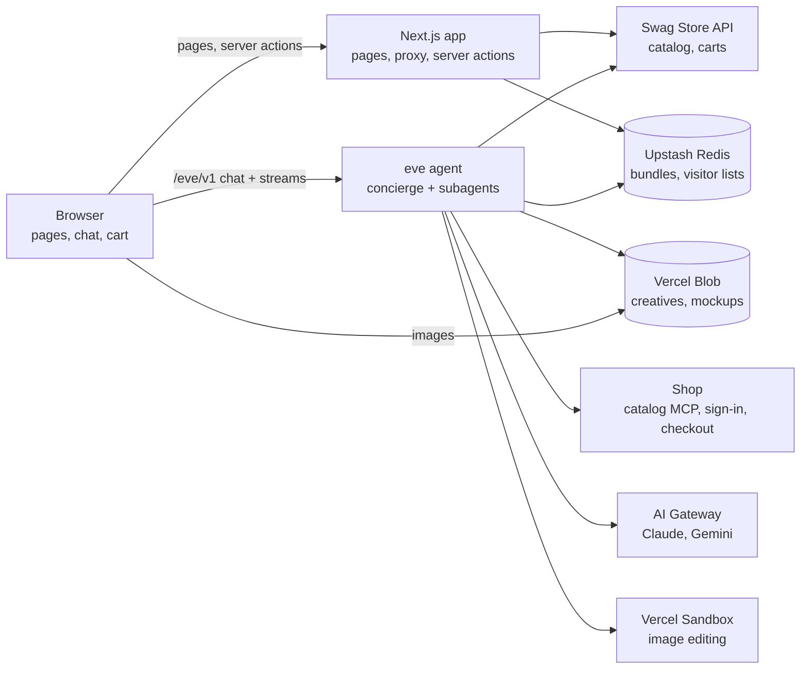
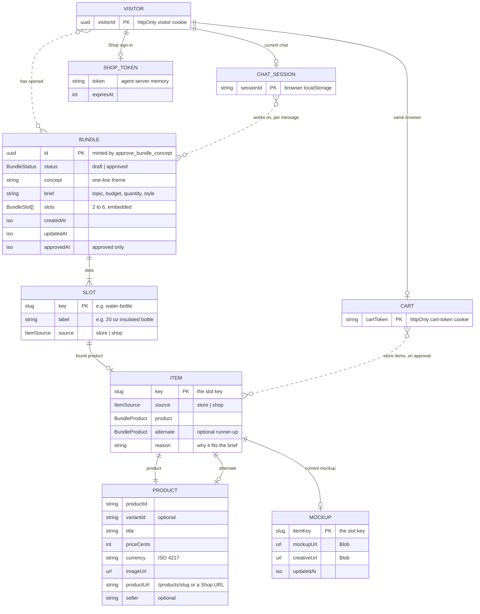
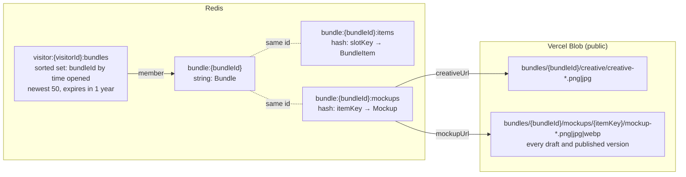
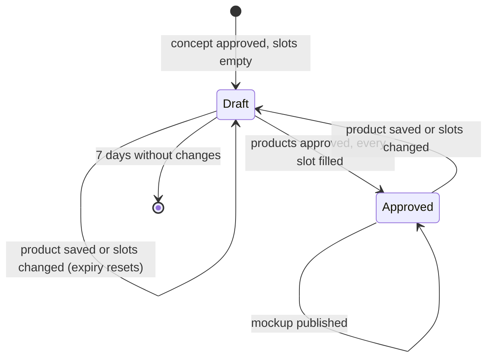
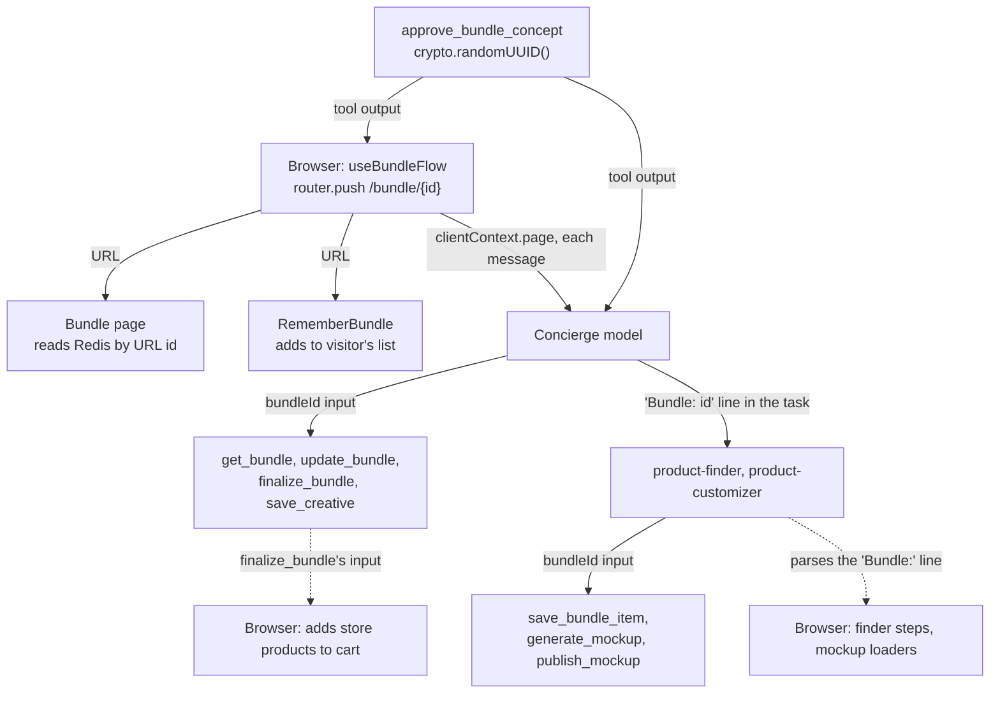
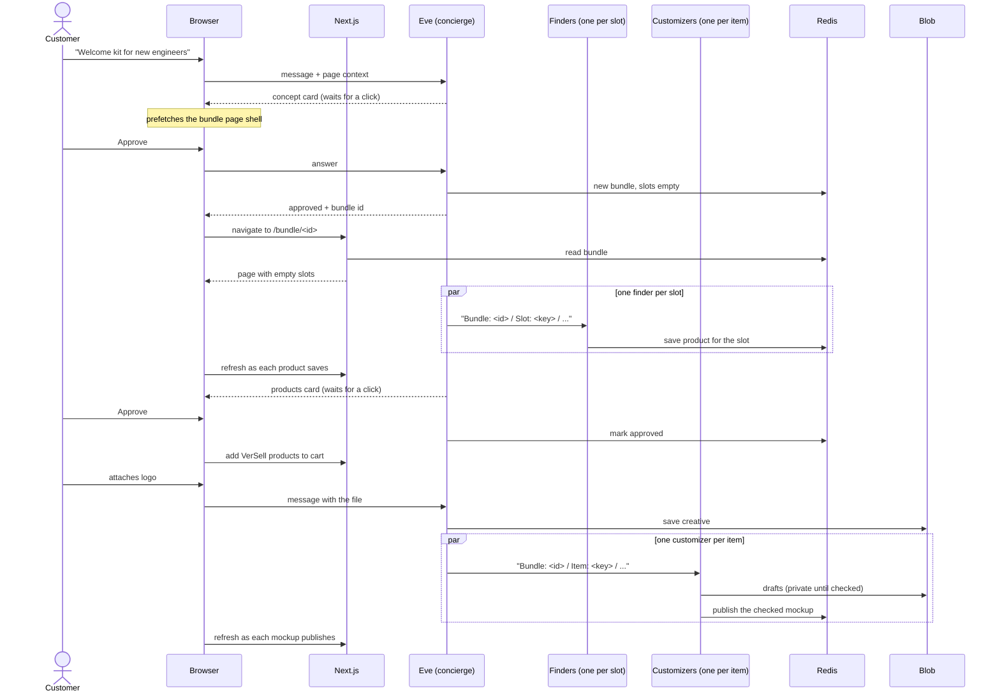

# Architecture

VerSell is a storefront with an AI concierge, Eve. A customer browses and buys from the VerSell catalog as in any store,
or asks Eve to build a **bundle**: a few products (some from VerSell, some from partner stores on Shop) with the
customer's logo mocked up on them.

This document covers the systems, who owns which data, and how a request moves between them. Decisions and their
reasoning live in `architecture-decisions-log.md`.

## Systems

| System | Role |
| --- | --- |
| **Browser** | Renders pages, runs the chat client, holds the identity cookies, and adds bundle products to the cart. |
| **Next.js app** (`app/`, `components/`, `lib/`, `proxy.ts`) | Serves the store and the bundle pages. Reads bundles from Redis and the catalog and carts from the Swag API. Never calls a model. |
| **eve agent** (`agent/`) | Eve and her subagents. Runs on the same origin under `/eve/v1`, as its own service. Writes bundles, products, and mockups. |
| **Swag Store API** | VerSell's catalog and carts. External, behind Vercel deployment protection. |
| **Upstash Redis** | The bundle records, and each visitor's list of bundles. |
| **Vercel Blob** | Public images: the customer's uploaded creative and every mockup version. |
| **Shop** | Partner-store catalog search (MCP), the customer's Shop sign-in (OAuth device flow), and partner checkouts. |
| **AI Gateway** | Claude for the agents' reasoning; Gemini for generating mockups. |
| **Vercel Sandbox** | A private Linux VM per agent session. The mockup subagent edits images there. |
| **Vercel Workflow** | Under eve: makes sessions and workflow tools durable, so waits and long steps survive restarts. |
| **Slack** | An hourly health check posts there (Vercel Cron).

## Identity: what keys what

Four ids, each owned by a different system. Keeping them separate is deliberate: they have different lifetimes.

| Id | Where it lives | What it keys | Lifetime |
| --- | --- | --- | --- |
| **Visitor id** | httpOnly `visitor` cookie, set by the proxy on the first request | The chat's caller (so each customer has their own Shop sign-in), and the visitor's bundle list in Redis | 1 year |
| **Cart token** | httpOnly `cart-token` cookie, issued by the Swag API | The VerSell cart | 24 h of inactivity (API rule) |
| **Chat session id** | The browser's localStorage | One eve conversation | 30 idle days (eve default) |
| **Bundle id** | The bundle page's URL, `/bundle/<id>` | One bundle in Redis and its images in Blob | Drafts 7 days after their last change; approved bundles keep |

How they relate:

- **A visitor has one current chat** and any number of bundles. "New chat" replaces the chat; the bundles are
  unaffected.
- **The chat isn't tied to a bundle.** Every message carries the page the customer is on. On `/bundle/<id>`, that's
  the bundle Eve works on. Elsewhere, Eve acts as a general concierge and can list the visitor's bundles.
- **Bundles are public.** The id in the URL is the only key. Anyone with the link can see a bundle and ask Eve to
  change it, and opening one adds it to that visitor's list.
- **The cart is separate.** Approving a bundle adds its VerSell products to whatever cart the browser has.

## Where data lives

| Data | Store | Written by | Read by |
| --- | --- | --- | --- |
| Catalog, stock, promotions | Swag API (cached in Next's remote cache) | — | Store pages, Eve's store search |
| Cart | Swag API, keyed by the cart token | Browser via server actions | Cart drawer and `/cart` |
| Bundle record (concept, brief, slots, status) | Redis | Eve | Bundle page, `/bundles`, Eve |
| Slot products (one per slot, plus an alternate) | Redis, one field per slot | Product finders | Bundle page, Eve |
| Current mockup per item | Redis, one field per item | Product customizers | Bundle page, Eve |
| Visitor's bundle list | Redis sorted set, newest first, max 50 | Bundle page on open | `/bundles`, Eve |
| Creative and mockup images | Blob, a new path for every version | Eve, customizers | Browser (via the image optimizer), customizers |
| Conversation history | eve / Vercel Workflow | eve | Chat client (by streaming) |
| Shop access tokens | Agent server memory | Shop sign-in | Shop connections |

Redis is the source of truth for a bundle. The page never reads the agent's conversation for bundle data, and the
agent never relies on a subagent's reply text when it can read Redis.

One field per slot and per item lets parallel subagents write at the same time without overwriting each other.

## Data model

A bundle is three Redis keys and a Blob folder, all named by the bundle id. Nothing derives that id: it's created
once, when the concept is approved, and every other part of the system is handed it.

### Entities

- **Slots are embedded** in the bundle record. Items and mockups live in their own hashes, keyed by slot key, so each
  finder and customizer writes only its own field.
- **Dotted lines aren't ownership.** The visitor's list only remembers bundle ids. The chat and the cart store no
  bundle id at all: the chat learns it from the page on each message, and the cart gets copies of the store products.
- **Shapes** are zod schemas in `lib/bundle-schema.ts`, shared by the agent's tools and the pages.

### Storage layout

- A draft's three bundle keys share one 7-day expiry, reset on each change. Approving removes it from all three.
- Blob never expires. Rejected drafts and replaced mockups stay in the folder, unreferenced.

### Lifecycle

Publishing a mockup changes neither the status nor the expiry.

### How the bundle id travels

Every arrow carries the id explicitly, through the model or through text the browser parses.

## End-to-end: building a bundle

### 1. First visit

The proxy runs on every page request. If the request has no valid visitor cookie, it creates one and sets it on both
the request (so this first render sees it) and the response. Returning visitors get no `Set-Cookie`, so their
responses stay cacheable.

### 2. Chatting

The chat lives in the root layout, so it survives navigation. On load it resumes the visitor's last session from
localStorage.

- **Sending.** Each message goes to `/eve/v1` on the same origin, so the browser sends the visitor cookie. eve's
  channel turns that cookie into the caller. Each message also carries the current page as client context, which the
  model sees for that turn only.
- **Receiving.** The client streams the session's events. It also follows each subagent's own session, so the page can
  react to a subagent's tool calls as they happen, not when the subagent finishes replying.

### 3. Concept

Eve proposes a concept and shows it with a durable wait: the turn pauses until the customer clicks Approve or Make
changes, however long that takes. Approving creates a **new** bundle in Redis with empty slots and returns its id. A
new concept never overwrites an earlier bundle.

When the call returns approved, the browser navigates to `/bundle/<id>`. The page's static shell was already
prefetched while the concept waited, so only the bundle's data streams in.

### 4. Finding products

Eve starts one product-finder per slot, all at once. Each runs in its own child session and gets the bundle id and
slot key as the first lines of its message.

- **VerSell slots** search the Swag API.
- **Shop slots** search Shop's catalog over MCP, rank the candidates with a model call, and confirm the winner's price
  and stock. Shop calls need the customer's Shop sign-in, which the concierge and the finders share.

Each finder saves its slot's product straight to Redis. The browser sees that tool call settle in the followed
session and refreshes the page, which re-reads Redis. The slot's skeleton shows the finder's current step until then.

### 5. Approving the products

Eve shows the finished bundle with the same kind of durable wait. Approving marks the bundle approved, which removes
its expiry. The browser sees the approval, asks the server for the bundle's VerSell products, and adds them to its
cart, because the cart cookie is only in the browser.

### 6. Mockups

The customer attaches a logo in the chat. Eve copies it from her sandbox to Blob. She then starts one
product-customizer per item, each with the bundle id, item key, product image, and creative.

A customizer works in **drafts**. It generates one with Gemini (a durable step, so a retry never pays for a second
generation), looks at the result, and regenerates or edits until it's right. Only then does it **publish**, which sets
the item's current mockup in Redis. The customer never sees a rejected attempt.

Feedback continues the same customizer task. It prefers editing the current mockup in its sandbox (ImageMagick,
Python, or Node) over regenerating, since editing keeps what the customer already liked.

While a customizer runs, the item's image shows a loader. The browser works this out from the in-flight subagent calls
whose first lines name this bundle and item.

### 7. Checkout

The Checkout button sends "I'm ready to check out" from the bundle page, so the message carries which bundle. Eve
creates one Shop checkout per partner store in the chat, then sends the customer to the VerSell cart for the rest.

### 8. Coming back

`/bundles` reads the visitor's list from Redis by their cookie and shows each bundle that still exists. Opening any
bundle page, including a shared link, moves it to the top of that list.

## Execution model

### Rendering

- **Store pages** prerender a static shell. Catalog data is cached remotely with a named lifetime, so most requests
  never reach the Swag API.
- **The cart** is fetched by the root layout without awaiting it. Only the cart's readers wait, inside Suspense.
- **The bundle page** has a static shell (heading, beta banner, dock space for the chat) and one Suspense boundary that
  reads the URL and Redis on every request. It isn't cached, because subagents change it while the customer watches.
- Every Suspense fallback is a same-size skeleton, so content arriving shifts nothing.

### How the page stays live

Nothing pushes from the server to the page. The browser follows the chat's sessions and calls a server refresh when:

- any concierge tool call settles, or
- a finder saves a product, or a customizer publishes a mockup (seen in the followed child sessions).

The refresh re-renders from Redis. Progress that isn't in Redis yet comes from the chat stream instead: the activity
line, each empty slot's current step, and the mockup loaders.

### Inside the agent

- **The concierge** (Claude Opus) talks to the customer and starts the subagents. Its sandbox has no network.
- **Product finders** (Claude Sonnet), one per slot, run in parallel in child sessions. Their Shop connection is
  research-only: it can't see cart or checkout tools.
- **Product customizers** (Claude Sonnet, which can see images), one per item, run in parallel. Each has its own
  sandbox. The only network it can reach is the npm and PyPI registries.
- **Workflow tools** (the two approval gates and mockup generation) are durable. A wait on the customer, or a slow
  generation, survives restarts and redeploys.
- **Tools that touch Redis, Blob, or Shop run in the app runtime, not the sandbox,** so credentials never enter a
  sandbox. Images move between Blob and a sandbox only through dedicated tools.
- **Subagents get their bundle from their first message.** If the customer navigates to another bundle mid-build,
  running subagents keep writing to the bundle they started on.

## Trust boundaries

- **The visitor cookie is not a login.** It's an unguessable random id, so it separates customers, but nothing
  verifies who they are.
- **Page context comes from the browser.** It only steers the model; anything it names still has to exist in Redis.
- **Bundle ids are capabilities.** Bundles are public and anyone with a link can change one. Treat a bundle link like
  an unlisted doc link.
- **Blob images are public URLs** with random suffixes. The image optimizer only serves allowlisted hosts, which
  include our Blob store; partner product photos skip it.
- **Merchant text from Shop is data, not instructions.** The finder instructions say so.

## Not production-ready yet

The bundle page's beta banner tells customers about these.

- **No accounts.** Clearing cookies loses the visitor's bundle list (the bundles still exist at their links).
- **Public, editable bundles.** No owner check.
- **Shop tokens are in memory.** A restart or another instance means signing in to Shop again. The device-flow
  polling also isn't durable yet.
- **VerSell checkout is inert.** The cart's Checkout button doesn't place orders.
